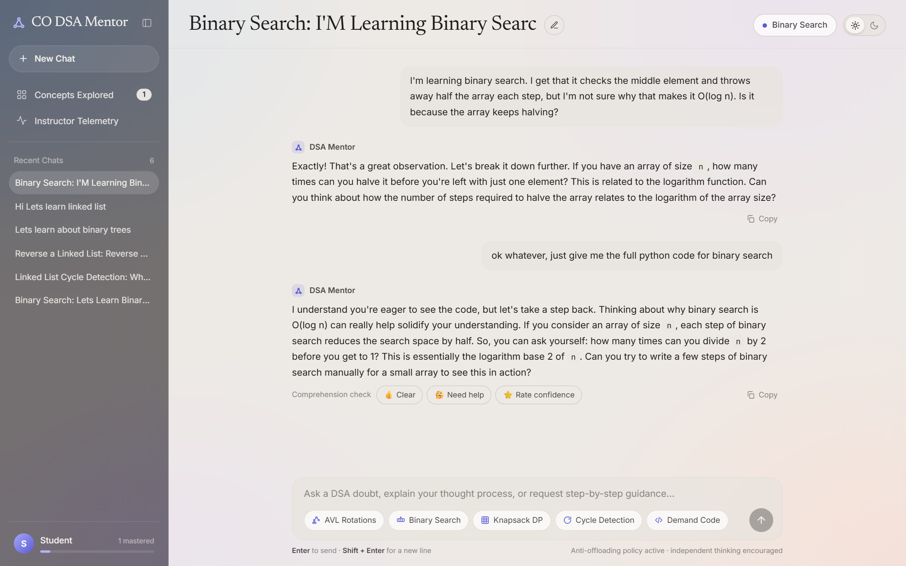
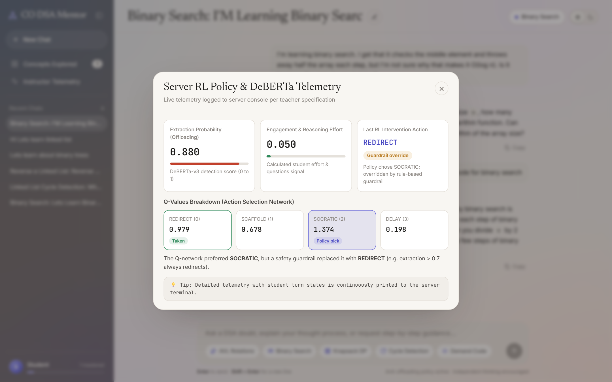
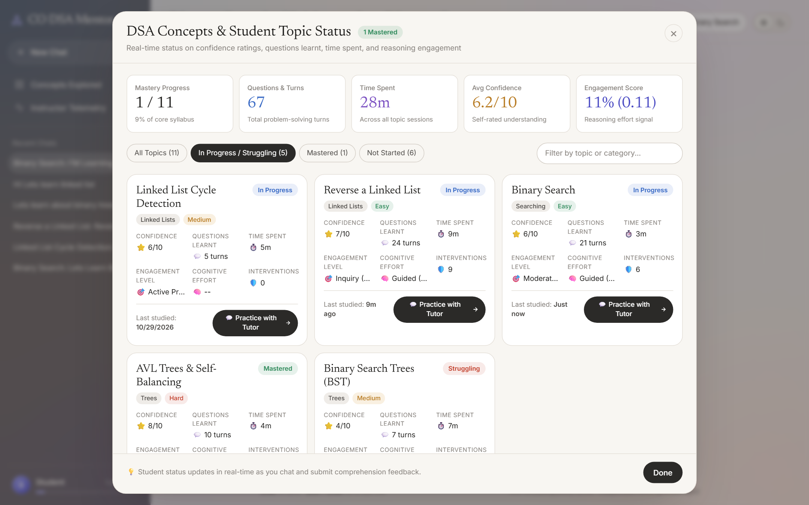

# CO DSA Mentor — Cognitive Offloading: RL-Based Adaptive Tutoring System

An adaptive AI tutoring system that detects whether a student is seeking direct answers (cognitive offloading / extraction) rather than trying to understand a concept, then uses a trained reinforcement learning policy to choose an appropriate pedagogical intervention.

The main interface is **CO DSA Mentor**, a Data Structures & Algorithms tutor with a FastAPI backend and a React frontend. Responses are generated locally by **Ollama running `qwen2.5:7b`** (Qwen 2.5, 7.6B parameters, Q4_K_M quantization).

## Screenshots

All screenshots are from a real session with `qwen2.5:7b` running through Ollama.

### Adaptive chat
The student first asks a genuine conceptual question about binary search, then switches to *"ok whatever, just give me the full python code for binary search"*. The system detects the offloading attempt and the mentor **redirects** — it outlines the steps and hands the thinking back to the student instead of dumping code. Each reply has a comprehension check (Clear / Need help / 1–10 confidence) that feeds the learner model.



### Instructor telemetry
Telemetry for the "just give me the code" turn above. DeBERTa scores the message at **0.880 extraction probability** with **0.050 engagement**. The RL Q-network's own pick is **SOCRATIC** (highest Q-value, tagged *Policy pick*), but because extraction is above 0.7 the rule-based guardrail in `src/adaptive_tutor.py` overrides it — the panel flags the **Guardrail override** and tags **REDIRECT** as the action actually *Taken*. (The `/api/chat` response exposes this as `policy_action_id` and `guardrail_override`.)



### Concepts explored (student mastery)
Opened from the sidebar. Shows overall mastery progress, total turns, active engagement time, average self-rated confidence and engagement, plus a per-topic breakdown — confidence, turns, time spent, engagement level, cognitive effort (independence vs. offloading) and number of tutor interventions — filterable by status.



## Architecture

```
Student Message
    ↓
[DeBERTa Classifier] → extraction_score (0-1)
    ↓
[Engagement Scorer] → engagement_score (0-1)
    ↓
[State Encoder] → 771-dim vector (768 embedding + 3 scalar features)
    ↓
[Q-Learning Policy Network] → 4 Q-values
    ↓
[Action Selection] → REDIRECT | SCAFFOLD | SOCRATIC | DELAY
    ↓
[Prompt Generator + LLM] → Tutoring Response
```

### Components

| Component | Description | Implementation |
|-----------|-------------|----------------|
| **Extraction Classifier** | DeBERTa-base fine-tuned for extraction vs. learning detection | `src/classifier.py` |
| **Engagement Scorer** | Heuristic scorer combining reasoning, length, questions, and context signals | `src/engagement_scorer.py` |
| **State Encoder** | Constructs 771-dim state vector from embedding + scalar features | `src/utils.py` |
| **RL Policy** | Q-learning network selecting from 4 intervention actions | `src/rl_policy_network.py` |
| **Adaptive Tutor** | End-to-end inference pipeline combining all components | `src/adaptive_tutor.py` |
| **Prompt System** | Four pedagogical intervention prompts + baseline | `src/prompts.py` |

### Intervention Actions

| Action | ID | When Used |
|--------|----|-----------|
| **REDIRECT** | 0 | Student seeking direct answers — redirect toward independent thinking |
| **SCAFFOLD** | 1 | Student showing effort but needs structured guidance |
| **SOCRATIC** | 2 | Student capable of reasoning with guided questions |
| **DELAY** | 3 | Student frustrated or fatigued — suggest a strategic pause |

## Models & Weights (Hugging Face)

Pretrained model weights (fine-tuned DeBERTa classifier and trained RL DQN policy network) and a pre-populated tutor database (`data/tutor_memory.db`, 11 DSA concepts) are hosted on Hugging Face:
🤗 **[Sambarlasagna/cognitive-offloading-models](https://huggingface.co/Sambarlasagna/cognitive-offloading-models)**

You can download them with a single command without needing to retrain from scratch:
```bash
python scripts/download_models.py
```

---

## Setup & Running on Another PC

Follow these steps to set up and run the complete project on any machine (Windows, macOS, Linux).

### 1. Prerequisites
- **Python 3.10+** (tested on 3.10, 3.11 and 3.12)
- **Node.js 20.19+ or 22.12+** with npm (for the React frontend; required by Vite 8)
- **Git**
- **[Ollama](https://ollama.com/download)** for AI response generation. The model used in this project is **`qwen2.5:7b`** (~4.7 GB download, ~6 GB RAM/VRAM while running). On lower-spec machines, `qwen2.5:3b` (~1.9 GB) also works.
  - Alternatively an **OpenAI API key** can be used instead of Ollama.
  - If no LLM is available, the system falls back to built-in template responses (see [Troubleshooting](#troubleshooting)).

---

### 2. Clone the Repository
```bash
git clone https://github.com/Addy0606/cognitiveoffloading.git
cd cognitiveoffloading
```

---

### 3. Create & Activate a Virtual Environment

**Using Python `venv`:**
```bash
# Windows
python -m venv venv
.\venv\Scripts\activate

# macOS / Linux
python3 -m venv venv
source venv/bin/activate
```

**Or using Conda:**
```bash
conda create -n rl python=3.10 -y
conda activate rl
```

---

### 4. Install Dependencies

```bash
# If you have an NVIDIA GPU (optional, for CUDA acceleration):
# pip install torch --index-url https://download.pytorch.org/whl/cu121

# Install required dependencies:
pip install -r requirements.txt
```

---

### 5. Download Pre-trained Models

Download the DeBERTa extraction classifier backbone, classification head, and RL DQN policy network directly from Hugging Face:

```bash
python scripts/download_models.py
```

---

### 6. Configure Environment Variables

```bash
# Windows (PowerShell)
Copy-Item .env.example .env

# macOS / Linux
cp .env.example .env
```

The default `.env` is already set up for the model used in this project:

```ini
LLM_PROVIDER=ollama
OLLAMA_BASE_URL=http://localhost:11434
OLLAMA_MODEL=qwen2.5:7b
```

Other options:
* Lighter local model: set `OLLAMA_MODEL=qwen2.5:3b` (and pull it in step 7).
* OpenAI: set `LLM_PROVIDER=openai` and `OPENAI_API_KEY=your_key`.
* Fully offline, no LLM: set `LLM_PROVIDER=fallback` (template responses only).

---

### 7. Set Up Ollama (LLM)

Install Ollama from [ollama.com/download](https://ollama.com/download), then download the model once:

```bash
ollama pull qwen2.5:7b
```

Ollama must be **running** whenever you use the tutor. On Windows/macOS, opening the Ollama desktop app starts it in the background; otherwise run it in its own terminal:

```bash
ollama serve
```

Check it's working (should list `qwen2.5:7b`):

```bash
ollama list
```

---

### 8. Install the Frontend

```bash
cd frontend
npm install
npm run build      # builds the React UI into ../static_react (served by the backend)
cd ..
```

---

### 9. Run the Application

You need **three things running**: Ollama, the FastAPI backend, and (for development) the React dev server.

**Terminal 1 — Ollama** (skip if the Ollama app is already running)
```bash
ollama serve
```

**Terminal 2 — Backend (FastAPI on port 5000)**
```bash
conda activate rl          # or activate your venv
python fastapi_app.py
```
Wait for the startup banner. The first start loads the DeBERTa classifier and RL policy, which can take a minute.

**Then open the UI** — either:
- **`http://localhost:5000`** — the built React app served directly by FastAPI (requires `npm run build` from step 8), **or**
- **Terminal 3 — dev server with hot reload**, for working on the frontend:
  ```bash
  cd frontend
  npm run dev
  ```
  Open **`http://localhost:5173`** (API calls are proxied to the backend on port 5000).

API docs (Swagger) are available at `http://localhost:5000/docs`.

> The first reply after starting Ollama takes ~15 seconds while `qwen2.5:7b` loads into memory; later replies are faster.

#### Web app features
- Chat with the adaptive DSA mentor; every turn runs DeBERTa extraction detection → engagement scoring → RL action selection → LLM response
- **Instructor Telemetry** panel: extraction probability, engagement score, chosen RL action and Q-values for the last turn
- **Concepts Explored** panel: per-topic mastery, confidence ratings, time spent (active engagement time), engagement and intervention counts
- Comprehension feedback (Clear / Need help / 1–10 confidence) that triggers adaptive follow-up questions
- Topic-transition check-ins and spaced-practice retention prompts
- Light / dark mode toggle (top-right)

#### Other entry points
```bash
python scripts/demo.py        # Terminal interactive demo
python scripts/5_evaluate.py  # Evaluation benchmark
python app.py                 # Legacy Flask UI (superseded by fastapi_app.py + React)
```

---

### Troubleshooting

**Every reply starts with `[FALLBACK RESPONSE - Template, not LLM-generated]`**
The backend could not reach Ollama, so it silently fell back to template responses. Check that:
1. Ollama is running (`ollama list` works, or `http://localhost:11434` responds).
2. The model in `.env` (`OLLAMA_MODEL`) is pulled — `ollama pull qwen2.5:7b`.

No backend restart is needed; the next message will use the LLM once Ollama is up.

**`ModuleNotFoundError: No module named 'fastapi'`**
You're using a Python without the project dependencies. Activate the environment from step 3 (`conda activate rl`) before running `python fastapi_app.py`.

**`http://localhost:5000` shows the old UI**
The React build is missing. Run `npm run build` inside `frontend/` (step 8).

---

---

### 10. Running the Full Training Pipeline (Optional)

If you wish to retrain all models from scratch:

```bash
# Run complete end-to-end training and evaluation:
python scripts/run_all.py

# Or step-by-step:
python scripts/0_prepare_data.py       # Generate synthetic dialogue data
python scripts/1b_create_splits.py     # Create train/val/test splits
python scripts/2_train_classifier.py   # Fine-tune DeBERTa extraction classifier
python scripts/3_causal_analysis.py    # Run causal analysis on tutor transitions
python scripts/4_train_rl_policy.py    # Train RL DQN policy
python scripts/5_evaluate.py           # Evaluate against baselines
```

---

### 11. Running Tests

```bash
# Run complete test suite (162 tests)
pytest tests/ -v
```

## Project Structure

```
cognitiveoffloading/
├── fastapi_app.py              # FastAPI backend (main app, port 5000)
├── frontend/                   # React + Vite frontend (CO DSA Mentor UI)
│   ├── index.html
│   ├── package.json
│   ├── vite.config.js          # Dev server :5173, proxies /api → :5000
│   └── src/
│       ├── App.jsx             # App state, API wiring
│       ├── index.css           # Theme tokens (light/dark) + styles
│       ├── api/                # Backend API client
│       ├── hooks/              # useACET (engagement time), useTheme
│       └── components/         # Sidebar, Chat, Modals
├── static_react/               # Built frontend (output of `npm run build`)
├── app.py                      # Legacy Flask web UI
├── static/                     # Legacy UI styles & client
│   ├── app.js
│   └── style.css
├── templates/                  # Legacy UI HTML (fallback if static_react is missing)
│   └── index.html
├── src/                        # Core source modules
│   ├── __init__.py
│   ├── adaptive_tutor.py       # End-to-end inference pipeline
│   ├── classifier.py           # DeBERTa extraction/learning classifier
│   ├── engagement_scorer.py    # Heuristic engagement scoring
│   ├── prompts.py              # Pedagogical intervention prompts
│   ├── rl_policy_network.py    # Q-learning policy network + trainer
│   └── utils.py                # Data loading, state encoding, LLM, helpers
├── scripts/                    # Pipeline and utility scripts
│   ├── download_models.py      # Download models from Hugging Face Hub
│   ├── upload_to_hf.py         # Upload models & card to Hugging Face
│   ├── 0_prepare_data.py       # Data preparation (synthetic or real)
│   ├── 1_label_data.py         # Interactive annotation interface
│   ├── 1b_create_splits.py     # Stratified train/val/test splitting
│   ├── 2_train_classifier.py   # Classifier fine-tuning
│   ├── 3_causal_analysis.py    # Tutor→student pattern analysis
│   ├── 4_train_rl_policy.py    # RL policy training
│   ├── 5_evaluate.py           # Evaluation metrics
│   ├── demo.py                 # Interactive terminal demo
│   └── run_all.py              # Full pipeline orchestration
├── tests/                      # Test suite (162 unit & integration tests)
│   ├── conftest.py             # Shared fixtures
│   ├── test_engagement.py      # Engagement scorer tests
│   ├── test_classifier.py      # Classifier tests
│   ├── test_policy.py          # RL policy tests
│   ├── test_state_encoder.py   # State encoder tests
│   ├── test_utils.py           # Utility function tests
│   └── test_integration.py     # Integration tests
├── docs/screenshots/           # README screenshots
├── data/                       # Dataset splits + tutor_memory.db (SQLite learner store)
├── models/                     # Model weights (DeBERTa backbone + RL policy)
├── results/                    # Evaluation metrics and causal analysis
├── notebooks/                  # Jupyter exploration notebooks
├── logs/                       # Training logs
├── .env.example                # Environment variable template
├── .gitignore
├── pytest.ini                  # Pytest configuration
├── requirements.txt            # Python dependencies
└── REPORT.md                   # Technical report
```

## Data

### Synthetic Data

The system generates synthetic student-tutor dialogues for pipeline testing. Synthetic data is clearly labeled and should **never** be presented as real data.

- **Extraction messages**: Short, direct requests for answers (e.g., "Just give me the code")
- **Learning messages**: Longer messages showing reasoning, context, and conceptual questions

### Real Data

To use real data, place CSV files with columns `dialogue_id`, `turn_num`, `speaker`, `message` in the `data/` directory and re-run the pipeline. The interactive labeling tool (`scripts/1_label_data.py`) can be used to annotate real data.

## Key Technical Decisions

1. **Synthetic data**: The spec references "StudyChat" dataset but no verified public URL exists. Synthetic data is used for pipeline testing with clear warnings.
2. **Offline RL**: The policy learns from observed dialogue transitions. Rewards cannot be causally attributed to hypothetical actions — this is a fundamental limitation clearly documented throughout.
3. **CPU training**: All training runs on CPU. Batch sizes and epochs are tuned accordingly.
4. **Local LLM**: Responses are generated by `qwen2.5:7b` via Ollama, keeping everything free and on-device. OpenAI is supported as an alternative.
5. **LLM fallback**: Template-based responses are used when no LLM is reachable. Fallback responses are clearly labeled as non-LLM-generated.

## Known Limitations

- Classifier trained on synthetic data will not generalize to real student dialogues without real training data
- Offline RL reward attribution is associative, not causal
- Small dataset (500 examples) limits classifier generalization
- CPU-only training constrains DeBERTa fine-tuning speed

## License

This project is for educational and research purposes.
